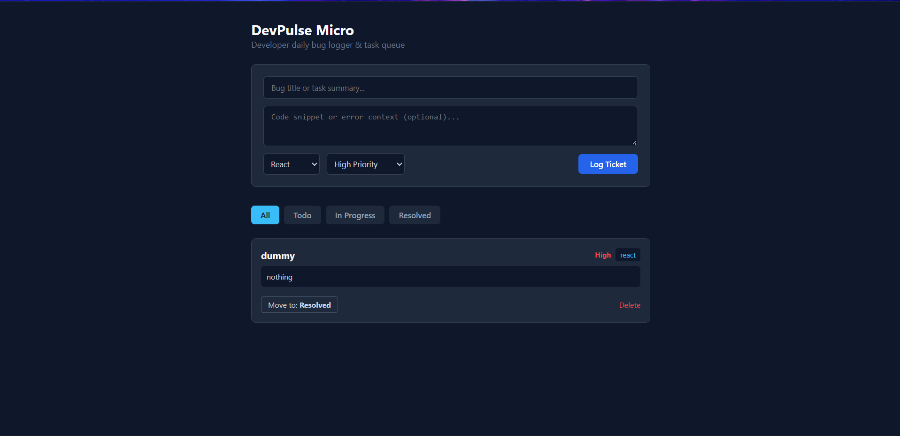

# DevPulse Micro — Developer Task & Bug Tracker

A functional, full-stack MERN application inspired by the DevPulse workflow, built to log developer tasks, track code snippets, set language tags, and manage issue lifecycles in real time.



---

## 1. Project Description
DevPulse Micro is a focused developer dashboard designed to record bugs, snippets, and daily action items. It features structured priority labeling, language categorization, and dynamic status updates.

## 2. Features
- **Full CRUD Support**: Create, inspect, update status, and remove issues and snippets.
- **Categorization**: Tag by language (JavaScript, React, Python, General) and priority (Low, Medium, High).
- **Status Pipeline**: Progress tasks through `Todo` ➔ `In Progress` ➔ `Resolved`.
- **Server-Side Filtering**: Query MongoDB directly by status (`?status=...`).
- **Dark Mode UI**: Clean, distraction-free interface built with React.

## 3. Technologies Used
- **Frontend**: React.js, Vite
- **Backend**: Node.js, Express.js
- **Database**: MongoDB, Mongoose ODM
- **Architecture**: RESTful API with CORS
- **AI Tooling & Assistance**: Code0 extension attempt, GitHub Copilot, Gemini

---

## 4. Setup and Installation

### Prerequisites
- Node.js (v18+)
- MongoDB running locally or a MongoDB Atlas URI

### Backend Setup
```bash
cd server
npm install

```

Create a `.env` file inside `/server`:

```env
PORT=5000
MONGO_URI=mongodb://127.0.0.1:27017/devpulse_micro

```

### Frontend Setup

```bash
cd ../client
npm install

```

---

## 5. How to Run the Application

1. **Start the Backend:**
```bash
cd server
npm run dev
# Server runs on http://localhost:5000

```


2. **Start the Frontend:**
```bash
cd client
npm run dev
# Client runs on http://localhost:5173

```


---

## 6. AI Development Tools Used

* **Primary Target Tool**: Code0 (`frigga.code0` VS Code extension)
* **Supporting AI Assistance**: GitHub Copilot & Gemini (utilized when navigating Code0 environment and credential limits)

---

## 7. AI Development Experience

During the build, Code0 was installed and configured inside VS Code to handle pair-programming tasks. However, the extension encountered environment credential dependencies requiring external model CLI subscriptions (Claude API keys).

To ensure the core task was completed reliably and without delaying project milestones, development continued using Copilot and Gemini to assist with schema design, state handling, and error-handling reviews.

---

## 8. Specific Tasks Where AI Tools Were Utilized

1. **Schema & Model Validation (Database Integration)**:
* Formulated the Mongoose schema with enum bounds for status and priority, along with automated timestamp generation.


2. **REST Controller Architecture (API Creation)**:
* Structured modular Express controller functions (`getIssues`, `createIssue`, `updateIssue`, `deleteIssue`) with explicit HTTP error response codes.


3. **Database Query Filtering (Backend Logic)**:
* Implemented database-level filtering using query parameters (`req.query.status`) to optimize API payload size.


4. **CORS & Environment Setup (Debugging)**:
* Resolved client-server communication headers between Vite (port 5173) and Express (port 5000).


5. **Component Lifecycle & UI State (Frontend Development)**:
* Structured the React state pipeline to trigger optimistic UI updates and handle active filter switches smoothly.

---